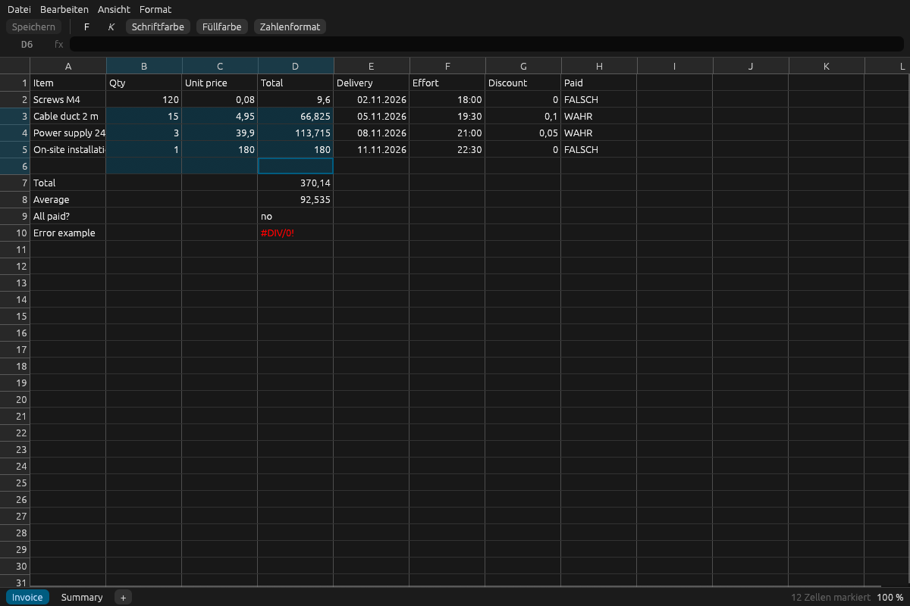

# ferrosheet

A fast, lightweight spreadsheet viewer written in Rust. Opens `.xls`, `.xlsx`, `.xlsm`, `.xlsb`,
`.ods` and `.csv`, shows them in under a second and gets out of the way.

<picture>
  <source media="(prefers-color-scheme: light)" srcset="docs/screenshot-light.png">
  
</picture>

## Why

I don't have a Microsoft licence any more, and I have no appetite for an office suite that
takes ages to start just so I can look at a file someone emailed me. I only want to open my
Excel files, find something, copy a few cells. With an AI subscription at hand the obvious
question was: why not port that small piece to Rust?

## What it does

- Opens xls, xlsx, xlsm, xlsb and ods, including multiple sheets
- Opens csv and tsv without questions: delimiter, encoding and decimal separator are
  detected; numbers become numbers, while postcodes, IDs and dates stay exactly as written
- Numbers, text, dates, durations, booleans and error values; formulas show their stored
  result in the cell and the formula itself in the formula bar
- Search across the current sheet or all sheets, as plain text or regular expression
- Select cells, rows, columns or everything; copy as tab-separated text that pastes into
  Excel, Google Sheets or an email
- Edit cells and formulas with recalculation ([IronCalc](https://github.com/ironcalc/IronCalc)),
  undo and redo, bold, italic, text and fill colour, number formats
- Save xlsx and csv in place (csv keeps its delimiter, encoding and decimal separator);
  xls, xlsb and ods are saved as a new `.xlsx`. Values and formulas are kept; fonts,
  borders and other formatting from the file may be lost
- Resize columns and rows by dragging, double-click an edge to fit the content
- Light and dark mode, following the system
- Damaged files end in an error message, never in a crash

It is a viewer first, with simple editing. See the [roadmap](docs/roadmap.md) and the honest
[comparison with LibreOffice Calc](docs/feature-parity.md).
The interface follows the system language: German on a German system, English everywhere
else (dates as `2026-11-02`, decimal point). Set `FERROSHEET_LANG=de` or `en` to override.

## Performance

Measured on a desktop PC with Windows 11, release build:

| | |
| --- | --- |
| Window visible | < 300 ms |
| Open a 100 000 × 30 `.xlsx` (11.7 MB): first rows / whole sheet | 11 ms / 0.73 s |
| Search 3 million cells | 45 ms (index built in the background after loading) |
| Download size | single `.exe` of about 12 MB, no installer |

Reproduce with `cargo run --release -p ferrosheet-core --example gen_big` and
`cargo run --release -p ferrosheet-core --example bench_load -- target/big.xlsx`.

## Install

Download the latest build from [Releases](https://github.com/10eputzen/ferrosheet/releases).

- **Windows:** unzip and run `ferrosheet.exe`. The exe is not signed yet, so SmartScreen warns
  on first start: *More info → Run anyway*. To open spreadsheets with a double-click, run
  `ferrosheet.exe --register` once and pick ferrosheet in the settings page that opens.
  `--unregister` removes it again. Both only touch the current user's registry.
- **Linux (x86_64):** `tar xzf ferrosheet-linux-x86_64.tar.gz && ./ferrosheet file.xlsx`.
  Built on Ubuntu 22.04, needs an X11 or Wayland desktop with OpenGL.
- **macOS:** not yet, see the [roadmap](docs/roadmap.md#platforms).

**Updates:** at start ferrosheet asks GitHub for the latest release tag, in the background and
nothing else is sent. If there is a newer version, it is downloaded in the background too, and only
then the status bar offers a restart. The restart is instant and comes back with the same
window, file and sheet; without it, the next start picks up the new version. Set `FERROSHEET_NO_UPDATE=1` to
turn the check off. Needs Windows 11 or a Linux with `curl` and `tar`.

From source, with Rust installed:

```bash
cargo install --path crates/ferrosheet
```

## Keyboard

| Keys | Action |
| --- | --- |
| Ctrl+O | Open a file (or drop it on the window) |
| Arrows, Tab | Move; Shift extends the selection (Shift+Tab moves back) |
| Typing, F2, Enter, double-click, click into the formula bar | Edit the cell; Enter saves and moves down, Tab right, Esc cancels |
| Delete | Empty the selected cells |
| Ctrl+Z, Ctrl+Y | Undo, redo |
| Ctrl+B, Ctrl+I | Bold, italic |
| Ctrl+S, Ctrl+Shift+S | Save, save as `.xlsx` |
| Ctrl+Arrows, Home/End, Ctrl+Home/End | Jump to the edge of the sheet or row |
| Page Up / Page Down | Scroll a screen |
| Ctrl+A | Select everything |
| Ctrl+C | Copy as shown |
| Ctrl+Shift+C | Copy raw values (dot as decimal separator, ISO dates) |
| Ctrl+F, F3, Shift+F3, Esc | Search, next hit, previous hit, close |
| Ctrl+Page Up / Page Down | Previous / next sheet |
| Ctrl+X | Cut (copy, then empty the cells) |
| Ctrl+Plus, Ctrl+Minus, Ctrl+0, Ctrl+wheel | Zoom the grid in, out, back to 100 % |

Mouse: click a column or row header to select it, drag a header edge to resize,
double-click an edge to fit. Right-click cells or headers for the usual menu.
Sheet tabs: "+" adds a sheet, double-click renames, right-click renames or deletes.
Everything is also in the menu bar (File, Edit, View, Format).

## How it is built

- [`ferrosheet-core`](crates/ferrosheet-core): reading files via [calamine](https://github.com/tafia/calamine),
  value formatting, selection, search and copy. No UI dependency.
- [`ferrosheet`](crates/ferrosheet): the app, [egui](https://github.com/emilk/egui)/eframe. Loading
  runs on a background thread; the grid only paints the visible cells, so a million rows
  scroll as smoothly as ten.

## Tests

```bash
cargo test --workspace
```

- Unit tests for formatting, selection, search and copy
- Robustness tests that truncate and corrupt every fixture and assert the reader never panics
- UI tests with [egui_kittest](https://github.com/emilk/egui/tree/main/crates/egui_kittest) that
  drive the whole app: open a workbook, press keys, copy, search, switch sheets, resize columns
- CI runs format, clippy and tests on Windows and Linux on every push; test coverage is measured weekly

## License

Licensed under either of [Apache License 2.0](LICENSE-APACHE) or [MIT license](LICENSE-MIT) at
your option. Test fixtures `date.*` come from the calamine test suite (MIT).
